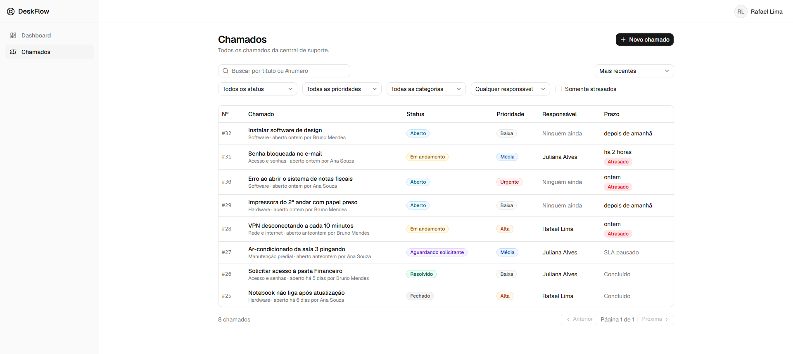
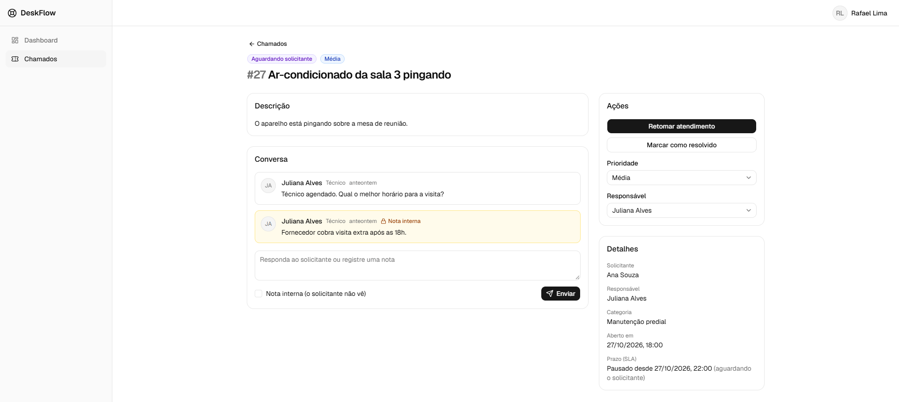
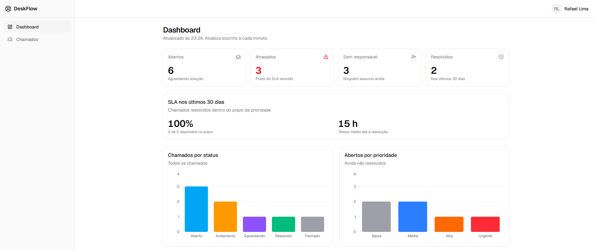

# DeskFlow

Central de chamados (service desk) com SLA, perfis de acesso, notas internas e dashboard. Uma equipe abre chamados; o suporte atende, conversa com quem pediu e acompanha os prazos.

**Demonstração:** https://deskflow-smoky.vercel.app · **Documentação da API:** https://deskflow-smoky.vercel.app/api/docs



## Experimente

Todas as contas usam a senha `demo-c3ab6f91`:

| Perfil | Nome | E-mail |
|---|---|---|
| Administrador | Marina Costa | `admin@deskflow.example` |
| Técnico | Rafael Lima | `rafael@deskflow.example` |
| Técnico | Juliana Alves | `juliana@deskflow.example` |
| Solicitante | Ana Souza | `ana@deskflow.example` |
| Solicitante | Bruno Mendes | `bruno@deskflow.example` |

Para ver o fluxo completo, abra um chamado como solicitante e atenda como técnico, numa janela anônima. Como administrador, dá para cadastrar pessoas e mudar perfis.

- **Os dados voltam ao original todo dia à meia-noite** (horário de Brasília): chamados, contas e categorias criados por visitantes são apagados, e os 8 chamados de exemplo são recriados.
- **As contas e categorias acima são protegidas:** a API não deixa trocar a senha delas, nem desativá-las ou alterá-las, para que ninguém tranque o próximo visitante do lado de fora.
- **A API fica desligada das 03h às 07h** (horário de Brasília), para economizar: nesse horário, o login não funciona.
- **Os dados são fictícios.** Os e-mails usam o domínio reservado `.example`.

## O que ele faz

| Recurso | Solicitante | Técnico | Administrador |
|---|---|---|---|
| Abrir chamados e acompanhar os próprios | ✅ | ✅ | ✅ |
| Ver todos os chamados, com filtros e busca | — | ✅ | ✅ |
| Assumir, mudar status, prioridade e responsável | — | ✅ | ✅ |
| Conversar no chamado | nos próprios | ✅ | ✅ |
| Notas internas (invisíveis ao solicitante) | — | ✅ | ✅ |
| Dashboard com indicadores de SLA | — | ✅ | ✅ |
| Gerenciar usuários e perfis | — | — | ✅ |

**SLA por prioridade:** urgente 4 h · alta 8 h · média 24 h · baixa 72 h. O prazo é recalculado quando a prioridade muda, **fica pausado enquanto o chamado aguarda o solicitante** (e é estendido pelo tempo da pausa quando o atendimento volta), e chamados vencidos aparecem como atrasados.

**Fluxo de status:** Aberto → Em andamento → Aguardando solicitante → Resolvido → Fechado. Cada perfil só pode fazer as transições permitidas a ele, e a API informa à tela quais são.

**Histórico:** cada mudança de status, prioridade ou responsável fica registrada, com quem fez e quando (`GET /api/tickets/{id}/events`).

| Detalhe do chamado | Dashboard |
|---|---|
|  |  |

## Arquitetura

```text
Navegador
   │ HTTPS
   ▼
Vercel (frontend React)
   │ /api/* repassado com um header secreto
   ▼
AWS CloudFront (HTTPS)
   │ HTTP, aceito só dos IPs do CloudFront (Security Group)
   ▼
EC2 t4g.micro · Docker · API Node.js + Express
   │ TLS com verificação de certificado, rede privada
   ▼
RDS PostgreSQL 17 (sem acesso público)
```

- O navegador fala só com o domínio da Vercel: o cookie da sessão é de primeira parte e não há CORS.
- A API recusa qualquer requisição que não tenha passado pela Vercel.
- O servidor não tem porta SSH: o acesso é pelo AWS Systems Manager Session Manager.
- O banco não tem IP público e só aceita conexões do Security Group da API.

## Stack

| Camada | Tecnologias |
|---|---|
| Frontend | React 19, TypeScript, Vite 8, Tailwind CSS 4, shadcn/ui (Radix), React Router 8, TanStack Query 5, React Hook Form, Zod 4, Recharts |
| Backend | Node.js 24, TypeScript, Express 5, Prisma 7, PostgreSQL 17, Zod 4, jose (JWT), argon2 |
| Qualidade | Vitest, Supertest, Testing Library, OpenAPI 3.1 gerado dos schemas Zod, Swagger UI |
| Infraestrutura | Docker, AWS (EC2, RDS, CloudFront, IAM, Systems Manager, EventBridge Scheduler), Vercel |

## Destaques técnicos

**Segurança**

- Senhas com argon2id; JWT de 15 minutos e refresh token rotativo, guardado como hash, com detecção de reuso (um token roubado e reutilizado encerra a sessão inteira).
- Refresh token em cookie `httpOnly`, `Secure`, `SameSite=Strict`, restrito a `/api/auth`; access token só na memória do navegador.
- Troca de senha encerra as sessões nos outros dispositivos; desativar uma pessoa ou mudar o perfil dela encerra todas as sessões dela.
- Rate limit no login e na API, com o IP real do visitante mesmo atrás de dois proxies.
- Validação com Zod no frontend e no backend; erros padronizados.
- Banco com dois usuários: as migrations usam o administrador; a API usa um usuário que só lê e grava dados, e que não consegue alterar nem apagar o histórico dos chamados.
- Cabeçalhos de segurança (Helmet na API; CSP e afins no site) e respostas da API com `Cache-Control: no-store`.

**Dados e concorrência**

- Duas pessoas alterando o mesmo chamado ao mesmo tempo: a segunda recebe 409 em vez de sobrescrever a primeira sem saber, e a tela busca o chamado de novo.
- Busca por trecho no título e na descrição com índices trigram (`pg_trgm`) no PostgreSQL.
- Regras de integridade também no banco (CHECK constraints), além da validação da API.

**Frontend**

- Renovação automática da sessão, com uma única renovação por vez (Promise compartilhada e Web Locks entre abas), para não disparar a detecção de reuso.
- Filtros na URL, busca com debounce, paginação sem "piscar" (com a próxima página pré-carregada) e estados de carregamento, vazio e erro em todas as telas.
- Páginas carregadas sob demanda: a biblioteca de gráficos só chega a quem abre o dashboard.
- Tema claro e escuro.

**Qualidade**

- 153 testes automatizados: 132 na API (unitários e de integração, com banco de dados real e isolado) e 21 de componentes no frontend.
- Documentação OpenAPI 3.1 gerada a partir dos mesmos schemas que validam as requisições.
- Conventional Commits e Pull Requests para cada etapa.

**Custos**

A infraestrutura roda com créditos do plano gratuito da AWS (cerca de US$ 25 por mês) e no plano Hobby da Vercel. O servidor e o banco desligam sozinhos das 03h às 07h, horário de Brasília (EventBridge Scheduler). Recursos caros comuns em produção (NAT Gateway, load balancer, Multi-AZ, Secrets Manager) foram deixados de fora de propósito, e estão listados como evolução.

## Rodando localmente

Pré-requisitos: Node.js 24, Docker.

```bash
# API
cd backend
cp .env.example .env        # e troque os valores de exemplo
docker compose up -d        # PostgreSQL 17
npm install
npx prisma migrate deploy
npm run db:seed
npm run dev                 # http://localhost:3333

# Frontend (outro terminal)
cd frontend
npm install
npm run dev                 # http://localhost:5173
```

Os usuários de exemplo (`admin@deskflow.example`, `rafael@deskflow.example`, `ana@deskflow.example`...) usam a senha definida em `SEED_USER_PASSWORD` no `.env`.

**Testes:**

```bash
cd backend
npm test                    # API (usa o banco de testes do TEST_DATABASE_URL)
cd ../frontend
npm test                    # componentes
```

## Estrutura

```text
backend/    API REST: módulos por domínio (auth, users, categories, tickets, ticket-events, comments, dashboard, health)
frontend/   SPA React: api/ (chamadas e cache), auth/ (sessão), pages/, components/
```

## Próximos passos

- Horário comercial no cálculo do SLA.
- Linha do tempo do histórico na tela do chamado (a API já registra os eventos).
- Convite por e-mail e tela de troca de senha (a rota já existe na API).
- Deploy automático pelo GitHub Actions, com o SSM Run Command.
- Segredos no AWS Secrets Manager ou no Parameter Store, com rotação.
- Domínio próprio com TLS de ponta a ponta.

## Autor

**Gustavo** · [LinkedIn](https://www.linkedin.com/in/gustavomaia-dev/) · [GitHub](https://github.com/Gusmaiadev)
